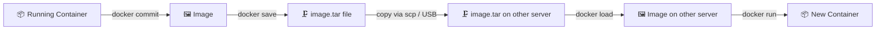
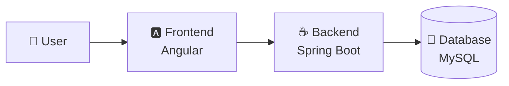

<div align="center">

# 🐳 Docker Zero to Hero

### Containerization & Docker Basics — Hands-On Guide


*Learn what containers are, how to build images, move them between machines, and run a full three-tier app with Docker Compose.*

</div>

---

## 📚 Table of Contents

| # | Topic | # | Topic |
|---|-------|---|-------|
| 1 | [Monolithic vs Microservices](#1--monolithic-vs-microservices) | 7 | [Save, Load & Commit](#7--save-load--commit-images-offline--snapshots) |
| 2 | [Traditional vs VM vs Containers](#2--traditional-vs-virtualization-vs-containerization) | 8 | [Docker Networking](#8--docker-networking) |
| 3 | [What is Docker?](#3--what-is-docker) | 9 | [Docker Volumes](#9--docker-volumes) |
| 4 | [Docker CE vs EE](#4--docker-ce-vs-docker-ee) | 10 | [Dockerfile](#10--dockerfile) |
| 5 | [Container Commands](#5--docker-container-commands) | 11 | [Docker Compose](#11--docker-compose--three-tier-app) |
| 6 | [Images, DockerHub & ECR](#6--docker-images-dockerhub--amazon-ecr) | 12 | [Cheat Sheet](#12--quick-cheat-sheet) |

---

## 1. 🏛️ Monolithic vs Microservices

<table>
<tr>
<td width="50%" valign="top">

### 🧱 Monolithic
- A **single, unified** application with tightly coupled components
- Hard to scale individual parts
- Any update means **redeploying everything**
- *Example:* a traditional web app where frontend, backend and database live in one codebase

</td>
<td width="50%" valign="top">

### 🧩 Microservices
- App is split into **small, independent services**
- Each service is developed, deployed and **scaled independently**
- Better **fault isolation** and easier technology upgrades
- *Example:* an e-commerce platform with separate auth, catalog and order services

</td>
</tr>
</table>


---

## 2. 🖥️ Traditional vs Virtualization vs Containerization

| Deployment Type | How it works | Weight |
|-----------------|--------------|:------:|
| 🏢 **Traditional** | Apps installed directly on physical servers → poor resource utilization | 🐘 Heavy |
| 🗄️ **Virtualization** | A hypervisor runs multiple VMs on one server; **each VM has its own OS** | 🐂 Medium |
| 📦 **Containerization** | Apps and dependencies are packaged together and **share the host OS kernel** | 🪶 Light |

### 📦 What is Containerization?
Packaging an application **and its dependencies** into an isolated environment called a *container*, so it runs the same everywhere — laptop, test server or cloud.

| Concept | Meaning |
|---------|---------|
| 📦 **Container** | A lightweight, standalone, executable package with everything needed to run an app |
| 🖼️ **Image** | A read-only template used to create containers (code + dependencies + runtime) |

> [!TIP]
> **Analogy:** an *image* is the recipe, a *container* is the dish cooked from it. You can cook the same dish many times from one recipe.

---

## 3. 🐳 What is Docker?

Docker is a platform for **developing, shipping and running** applications in containers.

**✨ Why use Docker?**
- ✅ Consistent environments across dev, test and production
- ✅ Lower infrastructure overhead and resource use
- ✅ Better scalability and portability

---

## 4. 🆚 Docker CE vs Docker EE

| Feature | 🆓 Docker CE (Community) | 💼 Docker EE (Enterprise) |
|---------|--------------------------|---------------------------|
| **License** | Open-source and free | Paid, with enterprise support |
| **Security** | Basic security features | Advanced security features |
| **Support** | Community support | Professional vendor support |
| **Management** | Basic container management | Advanced orchestration and management |

> [!NOTE]
> Docker EE was later acquired by Mirantis and is now sold as *Mirantis Container Runtime*. For learning and most projects, Docker CE is what you need.

---

## 5. 🛠️ Docker Container Commands

### 🔄 Container Lifecycle

| Action | Command | What it does |
|--------|---------|--------------|
| 🆕 Create | `docker create --name my_container ubuntu` | Creates a container but **does not start** it |
| ▶️ Run (interactive) | `docker run -it ubuntu` | Runs a container with an interactive terminal |
| 🌙 Run (detached) | `docker run -d --name my_container nginx` | Runs in the **background** |
| ⏹️ Stop | `docker stop my_container` | Gracefully stops a running container |
| 🔁 Start | `docker start my_container` | Starts an existing stopped container |
| 🗑️ Remove | `docker rm my_container` | Removes a **stopped** container |
| 📋 List running | `docker ps` | Shows active containers |
| 📜 List all | `docker ps -a` | Shows running **and** stopped containers |

### 🌍 Expose Applications to the World

```bash
# Map host port 8080 → container port 80
docker run -d -p 8080:80 nginx

# Pass environment variables
docker run -d -e "ENV_VAR=value" my_app

# Let Docker pick random host ports for all exposed ports
docker run -d -P nginx
```

### 🔌 Interact with Containers using `exec`

```bash
# Open a shell inside a running container
docker exec -it my_container bash

# Copy a file: host → container
docker cp my_file.txt my_container:/tmp/

# Copy a file: container → host
docker cp my_container:/tmp/my_file.txt ./
```

### 🔍 Inspect & Troubleshoot

```bash
docker inspect my_container     # Detailed metadata (JSON)
docker logs my_container        # View logs
docker logs -f my_container     # Follow logs in real time
docker stats                    # Live CPU, memory and network usage
```

### 🧪 Practice Lab

1. Create, start, stop and remove a container using the lifecycle commands
2. Expose nginx with `-p` and `-P` and open it in the browser
3. Use `docker exec -it` to explore inside a running container
4. Troubleshoot with `docker ps -a` → `docker logs` → `docker inspect`

### 🧹 Cleanup

```bash
# Force-remove ALL containers (running + stopped)
docker rm -f $(docker ps -aq)
```

> [!WARNING]
> This deletes **every** container on the machine. Use it only on practice systems.

---

## 6. 🖼️ Docker Images, DockerHub & Amazon ECR

### 🏷️ Image Naming Convention

```
<repository>/<image-name>:<tag>
```

```
r123mahajan/new:latest
 └─────┬────┘ └─┬─┘ └──┬──┘
   repository  image   tag (version)
```

- **Repository** — namespace or registry user (e.g. `nginx`, `ubuntu`, `r123mahajan`)
- **Image name** — a descriptive name
- **Tag** — version label (`latest`, `v1.0`, `20.04`)

### ☁️ Where do images live?

| | 🐙 DockerHub | 🟠 Amazon ECR |
|---|--------------|---------------|
| **What** | Cloud-based public/private registry | AWS-managed private container registry |
| **Highlights** | Official images (`nginx`, `mysql`, `ubuntu`), public and private repos | Integrates with ECS and EKS |
| **Auth** | Docker username/password or token | AWS IAM |

### 🧰 Image Commands

| # | Action | Command |
|---|--------|---------|
| 1 | ⬇️ Pull | `docker pull nginx:latest` |
| 2 | 🔐 Login (DockerHub) | `docker login -u r123mahajan` |
| 3 | 🔐 Login (ECR) | see below ⬇️ |
| 4 | ⬆️ Push | `docker push myrepo/myapp:v1` |
| 5 | 🏷️ Tag | `docker tag my-app:latest myrepo/my-app:v2` |
| 6 | 📋 List | `docker images` |
| 7 | 🗑️ Remove | `docker rmi nginx:latest` |

```bash
# Login to Amazon ECR
aws ecr get-login-password --region <region> | \
  docker login --username AWS --password-stdin <account-id>.dkr.ecr.<region>.amazonaws.com
```

```bash
# Delete ALL images
docker rmi -f $(docker images -aq)
```

---

## 7. 💾 Save, Load & Commit (Images Offline & Snapshots)

Need to move an image to a server **without internet** or without a registry? Or capture the state of a container you modified? These three commands do exactly that.



### 📸 `docker commit` — Container ➜ Image

Creates a **new image from a container's current state**.

```bash
docker commit <container-name-or-id> <new-image-name>:<tag>
```

```bash
# Example: customise a container, then snapshot it
docker run -it --name mybox ubuntu bash
#   (inside) apt update && apt install -y curl  → exit

docker commit mybox my-custom-image:v1
docker images        # my-custom-image:v1 now appears
```

> [!IMPORTANT]
> `docker commit` takes a **container**, not an image. Writing `docker commit <imagename>:<tag>` is incorrect — the first argument is the container, the second is the new image name.

### 🗜️ `docker save` — Image ➜ `.tar` file

Exports one or more images (with all layers, tags and history) into a tar archive.

```bash
docker save -o <file-name>.tar <image-name>:<tag>
```

```bash
docker save -o my-custom-image.tar my-custom-image:v1

# Save several images in one archive
docker save -o stack.tar nginx:latest mysql:8

# Optional: compress while saving
docker save my-custom-image:v1 | gzip > my-custom-image.tar.gz
```

> [!IMPORTANT]
> With `-o`, the **output filename comes first**, then the image: `docker save -o file.tar image:tag`. Writing `docker save -o image:tag` would use the image name as the filename and fail.

### 📥 `docker load` — `.tar` file ➜ Image

Restores image(s) from a tar archive created by `docker save`.

```bash
docker load -i <file-name>.tar
```

```bash
docker load -i my-custom-image.tar

# Compressed archives also work
docker load -i my-custom-image.tar.gz
# or:  gunzip -c my-custom-image.tar.gz | docker load
```

### 🚚 Full Offline Transfer Workflow

```bash
# 1️⃣ On the SOURCE machine
docker save -o myapp.tar myapp:v1

# 2️⃣ Copy the file to the target machine
scp myapp.tar user@target-server:/tmp/

# 3️⃣ On the TARGET machine
docker load -i /tmp/myapp.tar
docker run -d -p 80:80 myapp:v1
```

### 🔎 `save/load` vs `export/import` — Don't Mix Them Up

| | `save` / `load` | `export` / `import` |
|---|-----------------|---------------------|
| **Works on** | **Images** | **Containers** |
| **Keeps layers, tags & history** | ✅ Yes | ❌ No (flattened filesystem) |
| **Keeps CMD / ENV / ports metadata** | ✅ Yes | ❌ No |
| **Best for** | Moving images between hosts | Flattening a container's filesystem |

> [!TIP]
> Prefer `commit` for quick experiments and learning. For anything repeatable or production-bound, write a **Dockerfile** instead (see Section 10) — it is documented, versionable and reproducible.

---

## 8. 🌐 Docker Networking

Docker networking lets containers talk to each other, to the host, and to the outside world.

### 🚦 Network Drivers

| Driver | Description | Best for |
|--------|-------------|----------|
| 🌉 **Bridge** *(default)* | Default for new containers; containers on a **user-defined bridge** can reach each other by name | Standalone apps on one host |
| 🏠 **Host** | Removes isolation; container **shares the host's network stack** | High-performance apps |
| 🚫 **None** | No network interfaces at all | Security-sensitive, isolated workloads |
| 🕸️ **Overlay** | Connects containers across **multiple Docker hosts** (Swarm) | Multi-host clusters |
| 🪪 **Macvlan** | Gives a container its own MAC address so it looks like a physical device | Legacy apps needing direct network access |
| 🔀 **IPvlan** | Like Macvlan with finer control over IP assignment | Advanced IP management |

### 🧰 Network Commands

```bash
docker network ls                                  # List networks
docker network create my_custom_network            # Create
docker network inspect my_custom_network           # Inspect
docker network rm my_custom_network                # Remove

docker run -d --name my_container --network my_custom_network nginx   # Run on a network
docker network connect my_custom_network my_container                 # Attach existing container
docker network disconnect my_custom_network my_container              # Detach
```

### 🧪 Hands-On Lab

```bash
# Two containers on the same custom network
docker run -d --name container1 --network my_custom_network nginx
docker run -d --name container2 --network my_custom_network nginx

# Custom bridge network with your own subnet
docker network create --subnet "192.168.0.0/16" --driver bridge newnetwork

# Host networking (container uses the host's ports directly)
docker run -d --network host nginx:latest
```

> [!NOTE]
> With `--network host`, port mappings (`-p` / `-P`) are ignored because the container already shares the host's network.

---

## 9. 🗄️ Docker Volumes

Volumes **persist data** beyond the life of a container. They are managed by Docker and stored under `/var/lib/docker/volumes/`.

**Why volumes?**
- 💾 **Persistence** — data survives container removal
- 🧭 **Easy management** — handled by Docker itself
- ⚡ **Performance** — more efficient than bind mounts
- 📦 **Backup & restore** — simple to move between environments
- 🤝 **Sharing** — one volume can serve many containers

### 🧰 Volume Commands

| Action | Command |
|--------|---------|
| ➕ Create | `docker volume create my_volume` |
| 📋 List | `docker volume ls` |
| 🔍 Inspect | `docker volume inspect my_volume` |
| 🗑️ Remove | `docker volume rm my_volume` |
| 🧹 Remove all unused | `docker volume prune` |

### 🔗 Using Volumes with Containers

```bash
# Attach a volume to /data
docker run -d --name my_container -v my_volume:/data nginx

# Share a volume between containers
docker run -d --name container1 -v shared_volume:/data nginx
docker run -d --name container2 --volumes-from container1 nginx
```

---

## 10. 📝 Dockerfile

A **Dockerfile** is a script of instructions that automates building a Docker image — the repeatable, version-controlled alternative to `docker commit`.

### 🧱 Key Instructions

| Instruction | Purpose | Example |
|-------------|---------|---------|
| `FROM` | Base image | `FROM ubuntu:latest` |
| `LABEL` | Metadata (author, description) | `LABEL maintainer="Your Name <you@example.com>"` |
| `RUN` | Run commands **at build time** | `RUN apt update && apt install -y nginx` |
| `CMD` | Default command at container start | `CMD ["nginx", "-g", "daemon off;"]` |
| `ENTRYPOINT` | Fixed command; `CMD` supplies default arguments | `ENTRYPOINT ["nginx"]` |
| `ENV` | Environment variable (build + runtime) | `ENV APP_ENV=production` |
| `ARG` | Build-time variable | `ARG APP_VERSION=1.0` |
| `COPY` | Copy files from host into image | `COPY index.html /usr/share/nginx/html/` |
| `ADD` | Like `COPY`, also extracts archives / fetches URLs | `ADD archive.tar.gz /app/` |
| `EXPOSE` | Documents the listening port | `EXPOSE 80` |
| `USER` | User for subsequent commands | `USER nginx` |
| `WORKDIR` | Working directory | `WORKDIR /app` |

### 📄 Sample Dockerfile

```dockerfile
FROM ubuntu:latest
LABEL maintainer="Your Name <you@example.com>"

RUN apt update && apt install -y nginx
COPY index.html /usr/share/nginx/html/

EXPOSE 80
CMD ["nginx", "-g", "daemon off;"]
```

### 🏗️ Build ➜ Ship ➜ Run

```bash
# Build
docker build -t my-image .

# Push to Docker Hub
docker login
docker tag my-image username/my-image
docker push username/my-image

# Pull and run anywhere
docker pull username/my-image
docker run -d -p 80:80 my-image
```

---

## 11. 🎼 Docker Compose — Three-Tier App

**Docker Compose** defines and runs **multi-container applications** from a single YAML file.

**✨ Key features**
1. 📄 **Single configuration** — all services in one `docker-compose.yml`
2. 🎛️ **Multi-container management** — orchestrate the whole stack together
3. 🚀 **Easy commands** — `docker compose up` / `docker compose down`
4. 📈 **Scalable** — scale individual services

### 🏢 Three-Tier Architecture



| Tier | Technology | Role |
|------|-----------|------|
| 🎨 **Frontend** | Angular | UI layer |
| ⚙️ **Backend** | Spring Boot | Business logic layer |
| 🗃️ **Database** | MySQL | Data layer |

### ✅ Prerequisites
- Docker and Docker Compose installed
- Basic understanding of Docker and containers

### ▶️ Build and Start

```bash
docker compose up --build        # newer Docker (plugin)
# or
docker-compose up --build        # older standalone binary
```

```bash
docker compose down              # stop and remove the stack
```

---

## 12. ⚡ Quick Cheat Sheet

| Goal | Command |
|------|---------|
| Run a container in background | `docker run -d --name web -p 8080:80 nginx` |
| Shell into a container | `docker exec -it web bash` |
| Follow logs | `docker logs -f web` |
| Snapshot container → image | `docker commit web my-image:v1` |
| Image → tar file | `docker save -o my-image.tar my-image:v1` |
| Tar file → image | `docker load -i my-image.tar` |
| Build from Dockerfile | `docker build -t my-image .` |
| Push to registry | `docker push username/my-image:v1` |
| Remove all containers | `docker rm -f $(docker ps -aq)` |
| Remove all images | `docker rmi -f $(docker images -aq)` |
| Clean unused data | `docker system prune` |

---

<div align="center">

### 🎉 Happy Containerizing!

**Made with ❤️ for DevOps learners** · ⭐ Star this repo if it helped you

</div>
