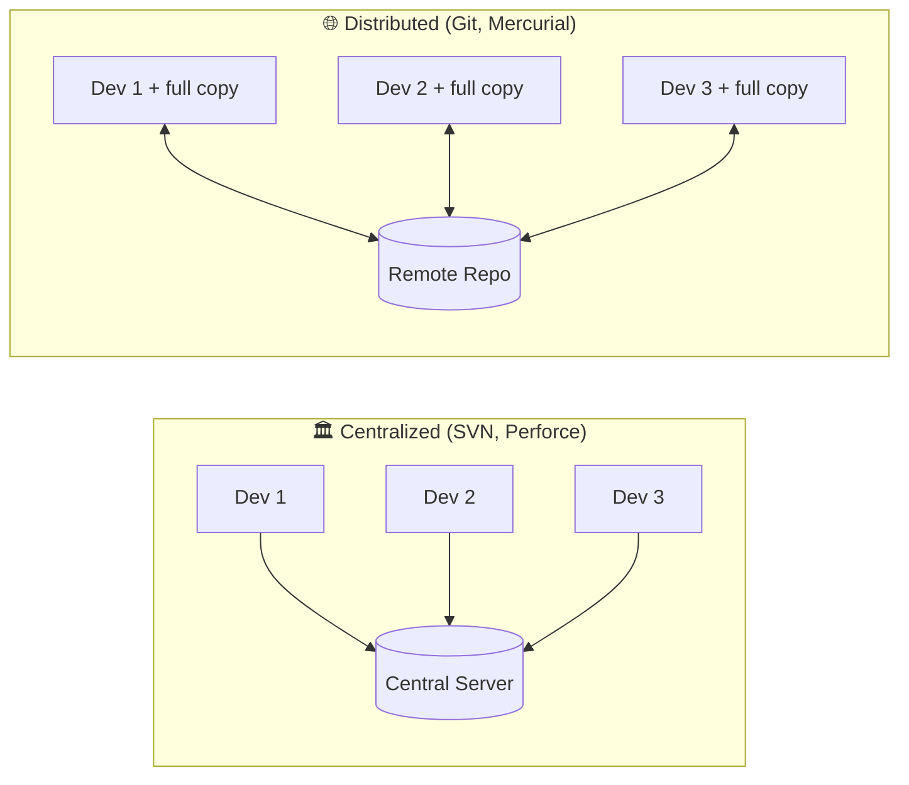
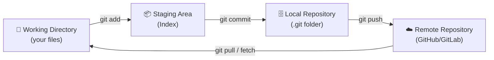
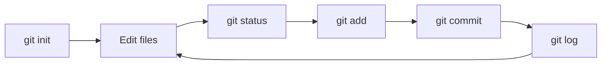
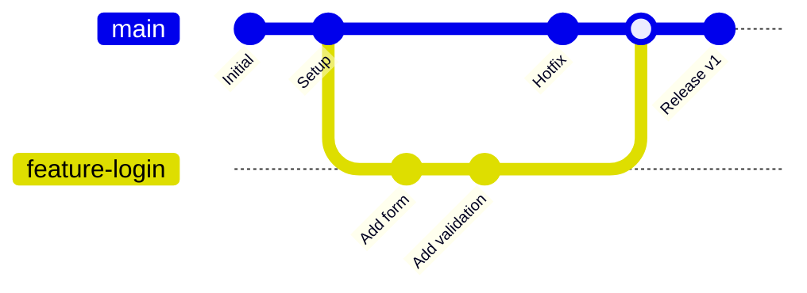
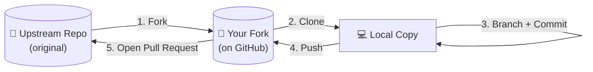
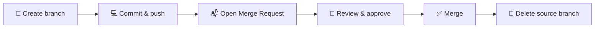
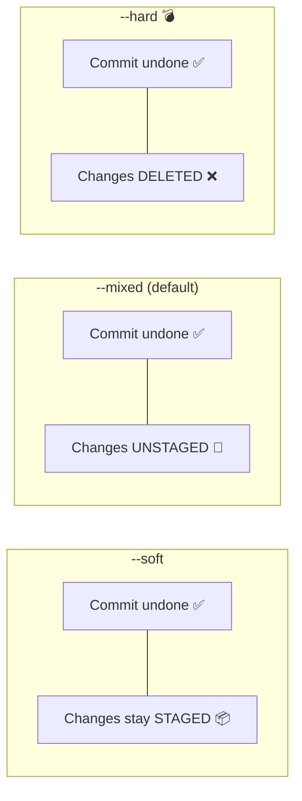
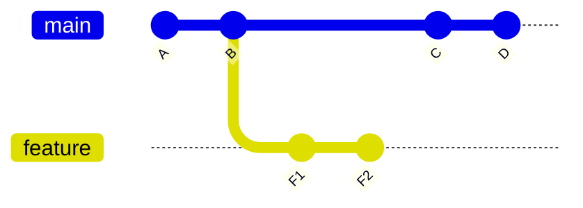
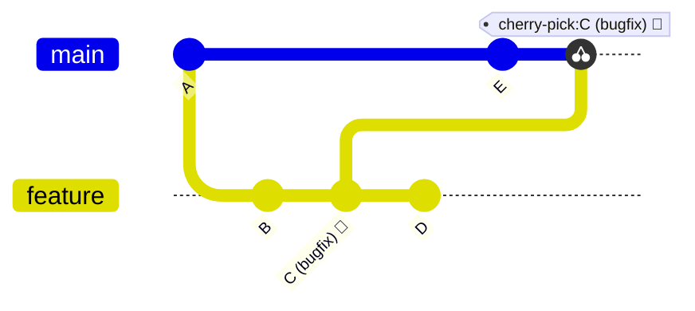

<div align="center">

# 🌳 Git & GitHub — The Complete Field Guide

### *From "what is version control?" to rebasing like a pro*


**Level:** 🟢 Beginner → 🟡 Intermediate &nbsp;|&nbsp; **Track:** DevOps Fundamentals

</div>

---

## 📚 Table of Contents

| # | Chapter | What you'll learn |
|---|---------|-------------------|
| 1 | [🧭 SCM Basics](#1--scm-basics) | Why version control exists, CVCS vs DVCS |
| 2 | [🌱 Intro to Git](#2--introduction-to-git) | What Git is, the 4-stage lifecycle |
| 3 | [⚙️ Installation & Setup](#3-️-installing--configuring-git) | Windows, Linux, Mac + first config |
| 4 | [🛠️ Local Repo Commands](#4-️-working-on-a-local-repo) | init, add, commit, log, status, revert, restore |
| 5 | [🙈 .gitignore](#5--gitignore) | Keep secrets and junk out of Git |
| 6 | [🌿 Branching](#6--branching) | Branch types, checkout, merge, diff |
| 7 | [☁️ Remote Repos](#7-️-remote-repositories) | clone, pull, push, remote |
| 8 | [🐙 GitHub Collaboration](#8--collaborating-with-github) | Dashboard, public/private, fork, PRs, SSH |
| 9 | [🦊 GitLab](#9--gitlab) | GitHub vs GitLab, CE vs EE, merge requests |
| 10 | [💥 Resolving Conflicts](#10--resolving-merge-conflicts) | Fix them without panic |
| 11 | [🧙 Advanced Git](#11--advanced-git-magic) | reset, restore, revert, rebase, cherry-pick, stash, tag |
| 12 | [💻 IDE & VS Code](#12--ide--visual-studio-code) | Install VS Code, Git integration, Auto Fetch |
| 13 | [🧾 Cheat Sheet](#13--the-ultimate-cheat-sheet) | Everything on one page |

---

## 1. 🧭 SCM Basics

### What is SCM?

**SCM (Source Code Management)** is the practice of **tracking and managing changes to code** over time.

> 💡 **Think of it as "Ctrl+Z for your entire project", plus a time machine, plus a teamwork tool.**

**Why do we need it?**

- 📜 **History:** see who changed what, when, and why
- 🤝 **Collaboration:** many developers, one codebase, no overwriting each other
- 🔙 **Rollback:** a bug shipped? Go back to the last good version
- 🌿 **Parallel work:** build features without breaking production
- 💾 **Backup:** your code lives in more than one place

### ⚔️ Centralized VCS vs Distributed VCS



| Feature | 🏛️ Centralized (CVCS) | 🌐 Distributed (DVCS) |
|---|---|---|
| **Repository** | One single central repo | Every developer has a full copy (local + remote) |
| **Example tools** | SVN, Perforce | **Git**, Mercurial |
| **Offline work** | ❌ Not possible | ✅ Commit locally, push later |
| **Speed** | 🐢 Slower (talks to the server) | ⚡ Fast (local operations) |
| **Collaboration** | Needs network access | Work offline, sync when ready |
| **Single point of failure** | ⚠️ Yes, if the server dies, history is at risk | ✅ No, every clone is a backup |

---

## 2. 🌱 Introduction to Git

**Git** is a **Distributed Version Control System (DVCS)** created by **Linus Torvalds in 2005** (the same person who created Linux). It tracks changes, supports cheap branching, and lets teams collaborate efficiently.

> 🧠 **Git ≠ GitHub.**
> **Git** is the *tool* on your computer. **GitHub / GitLab / Bitbucket** are *websites* that host Git repositories.

### 🔄 The Git Lifecycle



| Stage | Think of it as... | Description |
|---|---|---|
| 📝 **Working Directory** | Your desk | Where you edit files |
| 📦 **Staging Area (Index)** | The shopping basket | Files you've *selected* for the next commit |
| 🗄️ **Local Repository** | The checkout receipt | Commits saved permanently in the `.git` folder |
| ☁️ **Remote Repository** | The cloud warehouse | GitHub/GitLab copy shared with the team |

### 🏷️ The 3 States of a File

`Modified` ✏️ → `Staged` 📦 → `Committed` ✅

---

## 3. ⚙️ Installing & Configuring Git

### 🪟 Windows
1. Download from [git-scm.com/downloads](https://git-scm.com/downloads)
2. Run the installer with the default settings
3. Verify:
   ```sh
   git --version
   ```

### 🐧 Linux (Debian/Ubuntu)
```sh
sudo apt update
sudo apt install git -y
git --version
```

### 🍎 Mac
```sh
brew install git
git --version
```

### 🪪 First-Time Setup (do this once!)

```sh
git config --global user.name  "Your Name"
git config --global user.email "your.email@example.com"
git config --global init.defaultBranch main     # modern default branch name
git config --global core.editor "code --wait"   # use VS Code as editor
git config --list                                # view all settings
```

> 📌 Your name and email are stamped on **every commit** you make. Use the same email as your GitHub account so commits link to your profile.

**Config levels:** `--system` (all users) → `--global` (your user) → `--local` (this repo only). Local overrides global.

---

## 4. 🛠️ Working on a Local Repo

### 🎬 The Everyday Workflow



### `git init` — Start a repository
```sh
git init
```
Creates a hidden `.git` folder in the current directory. That folder **is** your repository.

### `git status` — Where am I?
```sh
git status
```
Shows modified, staged, and untracked files. **Your best friend. Run it often.**

### `git add` — Stage your changes
```sh
git add <filename>      # one file
git add .               # everything in the current directory
git add -p              # pick changes chunk by chunk (interactive)
```

### `git commit` — Save a snapshot
```sh
git commit -m "Initial commit"
```
Saves the staged changes with a message.

**Shortcut:** stage *and* commit already-tracked files in one go:
```sh
git commit -a -m "update"
```
> ⚠️ `-a` only picks up files Git **already tracks**. Brand-new files still need `git add`.

**Fix the last commit** (message typo, or forgot a file):
```sh
git commit --amend -m "Better message"
```
> 🚨 Don't amend commits you've already pushed to a shared branch.

### ✍️ Writing Good Commit Messages

| ❌ Bad | ✅ Good |
|---|---|
| `update` | `Add login validation for empty password` |
| `fix` | `Fix crash when cart is empty` |
| `changes` | `Refactor payment module into separate service` |

> 💡 Write in the imperative mood: "Add feature", not "Added feature".

### `git log` — View history
```sh
git log                          # full history
git log --oneline                # compact, one line per commit
git log --oneline --graph --all  # 🌳 branch tree view
git log -n 5                     # last 5 commits
git log --author="Rohit"         # filter by author
```

### `git diff` — See what changed
```sh
git diff                 # unstaged changes
git diff --staged        # staged changes
git diff <b1> <b2>       # compare two branches
```

### `git revert` — Safely undo a commit
```sh
git revert <commit-hash>
```
Creates a **new commit** that cancels out the old one. History is preserved, so it's **safe for shared branches**. ✅

### `git restore` — Undo local changes
```sh
git restore <filename>             # discard unstaged changes in a file
git restore --staged <filename>    # unstage a file (keeps your edits)
```

---

## 5. 🙈 .gitignore

The `.gitignore` file tells Git **which files to never track**: secrets, build output, dependencies, OS junk.

### Why it matters
- 🔐 Prevents leaking `.env` files, API keys, and AWS credentials
- 🧹 Keeps the repo clean and small
- ⚡ Avoids committing huge folders like `node_modules/`

### Create one
```sh
touch .gitignore
```

### Example `.gitignore`
```gitignore
# 🔐 Secrets
.env
*.pem
*.key
credentials.json

# 📦 Dependencies
node_modules/
venv/
__pycache__/

# 🏗️ Build output
dist/
build/
*.class

# 📝 Logs & temp files
*.log
tmp/
*.swp

# 💻 OS / IDE files
.DS_Store
Thumbs.db
.vscode/
.idea/

# ✅ Exception: ignore all .txt EXCEPT this one
*.txt
!important.txt
```

### Pattern cheat sheet

| Pattern | Meaning |
|---|---|
| `*.log` | Ignore all `.log` files |
| `folder/` | Ignore a whole folder |
| `!keep.txt` | **Don't** ignore this file (exception) |
| `/config.js` | Ignore only in the repo root |
| `**/temp` | Ignore `temp` in any directory |
| `#` | Comment |

> ⚠️ **Important:** `.gitignore` only affects **untracked** files. If a file is already committed, stop tracking it with:
> ```sh
> git rm --cached <filename>        # stop tracking a file
> git rm -r --cached <folder>/      # stop tracking a folder
> git commit -m "Stop tracking ignored files"
> ```
> 🔍 Debug why a file is ignored: `git check-ignore -v <filename>`

> 🎁 Need a template for your language? See [github.com/github/gitignore](https://github.com/github/gitignore).

---

## 6. 🌿 Branching

A **branch** is an independent line of development. Work on features, fixes, and experiments **without touching the stable code**.



### 🏷️ Common Types of Branches

| Branch | Purpose | Typical name |
|---|---|---|
| 🏠 **Main (Master)** | Production-ready code | `main` |
| ✨ **Feature** | Build a new feature | `feature/user-login` |
| 🐛 **Bugfix** | Fix a specific bug | `bugfix/cart-crash` |
| 📦 **Release** | Final testing before a version goes live | `release/v2.1` |
| 🚑 **Hotfix** | Emergency patch for production | `hotfix/payment-error` |

### 🧰 Branch Commands

| Command | What it does |
|---|---|
| `git branch` | 📋 List all local branches |
| `git branch -a` | 📋 List local + remote branches |
| `git branch <name>` | 🌱 Create a branch |
| `git checkout <name>` | 🔀 Switch to a branch |
| `git checkout -b <name>` | 🌱🔀 Create **and** switch |
| `git switch <name>` | 🔀 Modern way to switch |
| `git switch -c <name>` | 🌱🔀 Modern create + switch |
| `git branch -m <new-name>` | ✏️ Rename current branch |
| `git branch -d <name>` | 🗑️ Delete (safe, only if merged) |
| `git branch -D <name>` | 💣 Force delete |
| `git merge <name>` | 🔗 Merge a branch into the current one |
| `git diff <b1> <b2>` | 🔍 Compare two branches |

### 🔗 Merging

```sh
git checkout main
git merge feature-branch
```

**Two kinds of merge:**

| Type | When | Result |
|---|---|---|
| ⏩ **Fast-forward** | `main` hasn't moved since you branched | Pointer just moves ahead. Linear history, no merge commit |
| 🔀 **Three-way** | Both branches have new commits | Creates a **merge commit** joining both |

Force a merge commit even when fast-forward is possible: `git merge --no-ff feature-branch`

---

## 7. ☁️ Remote Repositories

A **remote repository** is a version of your project hosted online (GitHub, GitLab, Bitbucket) for **collaboration, backup, and deployment**.

### 🧰 Essential Commands

| Command | What it does |
|---|---|
| `git init` | Initialize a new local repo |
| `git config --global user.name "Your Name"` | Set your username |
| `git config --global user.email "you@example.com"` | Set your email |
| `git remote add origin <repo_URL>` | 🔗 Connect local repo to a remote |
| `git remote -v` | 👀 List configured remotes |
| `git clone <repo_URL>` | 📥 Download a remote repo to your machine |
| `git fetch` | 📡 Download changes **without** merging |
| `git pull origin <branch>` | ⬇️ Fetch + merge latest changes |
| `git push origin <branch>` | ⬆️ Upload your commits |
| `git push -u origin <branch>` | ⬆️ Push and set upstream (future `git push` is enough) |

> 💡 **`origin`** is just the default nickname for your remote URL.
> **`git pull` = `git fetch` + `git merge`**

### 🚀 Connect a Local Project to GitHub (step by step)

```sh
git init
git add .
git commit -m "Initial commit"
git branch -M main
git remote add origin https://github.com/<username>/<repo>.git
git push -u origin main
```

### 🎯 Full Workflow Example

```bash
# 1. Create a new branch
git checkout -b feature-branch

# 2. Work on changes
git add .
git commit -m "Added new feature"

# 3. Push the branch to GitHub
git push origin feature-branch

# 4. Merge changes into main
git checkout main
git merge feature-branch

# 5. Clean up
git branch -d feature-branch
```

---

## 8. 🐙 Collaborating with GitHub

### 🖥️ GitHub Dashboard Tour

| Area | What it's for |
|---|---|
| 🏠 **Home feed** | Activity from repos and people you follow |
| 📁 **Repositories** | All your repos (create new with the green **New** button) |
| 🔀 **Pull Requests** | PRs you opened or are asked to review |
| 🐞 **Issues** | Bugs, tasks, and feature requests |
| ⚙️ **Actions** | CI/CD automation workflows |
| 🔔 **Notifications** | Mentions, reviews, and updates |
| 👤 **Profile / Settings** | SSH keys, tokens, and preferences |

**Inside a repo:** `Code` · `Issues` · `Pull requests` · `Actions` · `Projects` · `Wiki` · `Security` · `Insights` · `Settings`

### 🔓🔒 Public vs Private Repositories

| | 🔓 Public | 🔒 Private |
|---|---|---|
| **Who can see it** | Anyone on the internet | Only you + people you invite |
| **Who can contribute** | Anyone can fork and open a PR; only collaborators can push | Only invited collaborators |
| **Best for** | Open source, portfolios, learning | Company code, client projects, secrets-adjacent work |
| **Cost** | Free | Free (with limits), more on paid plans |

> 🔐 Even in a private repo, **never commit passwords or keys**.

### 🔎 How to Search Public Repos

Use the search bar or go to [github.com/search](https://github.com/search). Handy filters:

```text
language:python stars:>1000          → popular Python projects
topic:devops                         → repos tagged "devops"
user:torvalds                        → repos from one user
"kubernetes" in:readme               → keyword inside README
good-first-issue:>5                  → beginner-friendly projects
pushed:>2025-01-01                   → recently active repos
```

Also try **Explore → Trending** to discover hot projects.

### 🍴 Fork & Pull Requests

**Fork** = your own personal copy of someone else's repo on GitHub.
**Pull Request (PR)** = a request asking the owner to merge *your* changes into *their* repo.



**Step by step:**

```sh
# 1. Click "Fork" on GitHub, then clone YOUR fork
git clone https://github.com/<your-username>/<repo>.git
cd <repo>

# 2. Add the original repo as "upstream"
git remote add upstream https://github.com/<original-owner>/<repo>.git

# 3. Create a branch for your change
git checkout -b fix-typo

# 4. Make changes, commit, push to YOUR fork
git add .
git commit -m "Fix typo in README"
git push origin fix-typo

# 5. On GitHub click "Compare & pull request"
```

**Keep your fork up to date:**
```sh
git fetch upstream
git checkout main
git merge upstream/main
git push origin main
```

**Good PR checklist ✅**
- Clear title and description (what + why)
- Small, focused changes
- Linked issue (`Closes #42`)
- Tests pass and no merge conflicts

### 🔑 Authentication Methods (HTTPS vs SSH)

GitHub **no longer accepts account passwords** for Git operations. Use one of these:

| | 🌐 HTTPS | 🔐 SSH |
|---|---|---|
| **URL looks like** | `https://github.com/user/repo.git` | `git@github.com:user/repo.git` |
| **Auth with** | Personal Access Token (PAT) | SSH key pair |
| **Setup effort** | Easy | Slightly more, but one-time |
| **Works behind firewalls** | ✅ Usually yes | ⚠️ Sometimes blocked (port 22) |
| **Best for** | Quick start, beginners | Daily use, no repeated prompts |

#### 🌐 Option 1: HTTPS + Personal Access Token
1. GitHub → **Settings → Developer settings → Personal access tokens**
2. Generate a token with the `repo` scope
3. When Git asks for a password, **paste the token**
4. Cache it: `git config --global credential.helper store`

#### 🔐 Option 2: SSH Keys (recommended)
```sh
# 1. Generate a key pair
ssh-keygen -t ed25519 -C "your.email@example.com"

# 2. Start the agent and add the key
eval "$(ssh-agent -s)"
ssh-add ~/.ssh/id_ed25519

# 3. Copy the PUBLIC key
cat ~/.ssh/id_ed25519.pub

# 4. GitHub → Settings → SSH and GPG keys → New SSH key → paste it

# 5. Test the connection
ssh -T git@github.com
```

Switch an existing repo from HTTPS to SSH:
```sh
git remote set-url origin git@github.com:<username>/<repo>.git
```

> 🚨 Share only the `.pub` file. **Never share your private key.**

---

## 9. 🦊 GitLab

### ⚔️ GitHub vs GitLab

| Feature | 🐙 GitHub | 🦊 GitLab |
|---|---|---|
| **Owned by** | Microsoft | GitLab Inc. |
| **Known for** | Largest open-source community | Complete built-in DevOps platform |
| **Merge terminology** | **Pull Request (PR)** | **Merge Request (MR)** |
| **CI/CD** | GitHub Actions (`.github/workflows/*.yml`) | Built-in GitLab CI/CD (`.gitlab-ci.yml`) |
| **Self-hosting** | Enterprise Server (paid) | ✅ Free Community Edition available |
| **Built-in extras** | Packages, Pages, Codespaces | Container registry, issue boards, security scanning, wiki |
| **Best for** | Open source, community, portfolios | End-to-end DevOps, self-hosted enterprises |

### 🆚 GitLab CE vs EE

| | 🟢 **CE (Community Edition)** | 🔵 **EE (Enterprise Edition)** |
|---|---|---|
| **Cost** | Free & open source (MIT license) | Free tier + paid tiers (Premium, Ultimate) |
| **Source code** | Fully open source | Open core, with proprietary paid features |
| **Core features** | Repos, issues, CI/CD, MRs | Everything in CE **plus** more |
| **Advanced features** | ❌ Limited | ✅ Advanced security scanning, compliance, audit events, SAML/SSO, code owners, advanced analytics, premium support |
| **Best for** | Small teams, learners, self-hosters | Large organizations with security/compliance needs |

### 🔀 How to Merge Branches in GitLab (Merge Request)



1. Push your branch: `git push origin feature-branch`
2. In GitLab, click **Create merge request** (the banner appears automatically)
3. Choose **source branch** → **target branch** (e.g. `feature-branch` → `main`)
4. Add title, description, reviewers, and assignee
5. Wait for the **CI pipeline** to pass ✅ and reviewers to approve
6. Click **Merge** (optionally tick *Delete source branch* / *Squash commits*)

**Merge options in GitLab:**

| Option | Result |
|---|---|
| **Merge commit** | Keeps all commits + adds a merge commit |
| **Squash and merge** | Combines all commits into one clean commit |
| **Fast-forward merge** | Linear history, no merge commit |

---

## 10. 💥 Resolving Merge Conflicts

A **conflict** happens when two branches change **the same lines** of the same file, and Git can't decide which to keep.

### 🔍 What a conflict looks like

```text
<<<<<<< HEAD
print("Hello from main branch")
=======
print("Hello from feature branch")
>>>>>>> feature-branch
```

| Marker | Meaning |
|---|---|
| `<<<<<<< HEAD` | Start: **your current branch's** version |
| `=======` | Divider |
| `>>>>>>> feature-branch` | End: **incoming branch's** version |

### 🩹 How to Resolve (step by step)

```sh
# 1. Try the merge, Git reports a conflict
git merge feature-branch
# CONFLICT (content): Merge conflict in app.py

# 2. See which files are conflicted
git status

# 3. Open the file and edit it: keep one side, or combine both
#    ...and DELETE the <<<<, ====, >>>> marker lines

# 4. Mark as resolved
git add app.py

# 5. Finish the merge
git commit            # or: git merge --continue
```

**Changed your mind? Abort and go back to safety:**
```sh
git merge --abort
```

**Quick shortcuts:**
```sh
git checkout --ours   <file>    # keep YOUR version
git checkout --theirs <file>    # keep THEIR version
```

> 💡 **How to avoid conflicts:** pull often, keep branches short-lived, make small commits, and talk to teammates about who's editing which files.

> 🎨 **VS Code makes this easy:** it highlights conflicts and shows clickable buttons: *Accept Current* · *Accept Incoming* · *Accept Both*.

---

## 11. 🧙 Advanced Git Magic

### 🎛️ The "Undo" Family, Know the Difference!

| Command | Affects | Changes history? | Safe on shared branches? |
|---|---|---|---|
| `git restore` | Working directory / staging | ❌ No | ✅ Yes |
| `git revert` | Creates a new "undo" commit | ➕ Adds a commit | ✅ Yes |
| `git reset` | Moves branch pointer | ⚠️ Rewrites | ❌ No (if already pushed) |
| `git rebase` | Replays commits | ⚠️ Rewrites | ❌ No (if already pushed) |

### ↩️ `git restore`: Fix files, not history

```sh
git restore <file>                 # discard changes in working dir
git restore .                      # discard ALL unstaged changes
git restore --staged <file>        # unstage (keep edits)
git restore --source=HEAD~2 <file> # bring back a file from 2 commits ago
```

### ⏪ `git reset`: Move back in time

`git reset` moves your branch pointer to an earlier commit. The **mode** decides what happens to your changes:



| Mode | Commit | Staging area | Working files |
|---|---|---|---|
| `--soft` | Undone | **Kept** (staged) | Kept |
| `--mixed` *(default)* | Undone | Cleared | **Kept** |
| `--hard` | Undone | Cleared | ❌ **Deleted** |

```sh
git reset --soft  HEAD~1      # undo last commit, keep changes staged
git reset         HEAD~1      # undo last commit, keep changes unstaged
git reset --hard  HEAD~1      # undo last commit AND destroy changes 💣
git reset --hard  <commit-hash>   # jump to a specific commit
git reset <file>              # unstage one file (older way)
```

> 🚨 **`--hard` is destructive.** Uncommitted work is gone for good.
> 🛟 **Safety net:** `git reflog` records every move of HEAD. Even after a bad reset, you can find the old commit hash and recover:
> ```sh
> git reflog
> git reset --hard <old-hash>
> ```

> ⚠️ After resetting commits that were **already pushed**, you'd need `git push --force-with-lease`, which rewrites shared history. Prefer **`git revert`** for shared branches.

### 🔁 `git rebase`: Rewrite history to keep it clean

**Rebase** takes your branch's commits and **replays them on top of another branch**, giving you a straight, linear history.



**Before rebase:** `feature` branched from **B**; `main` moved on to **C, D**.

```sh
git checkout feature
git rebase main
```

**After rebase:** `feature` commits are replayed after **D** (as new commits **F1'**, **F2'**), so the history is a straight line:

```text
A ── B ── C ── D ── F1' ── F2'
```

#### ⚔️ Merge vs Rebase

| | 🔀 `git merge` | 🔁 `git rebase` |
|---|---|---|
| **History** | Preserves true history, adds a merge commit | Linear, "as if you worked after main" |
| **Looks like** | A branching tree 🌳 | A straight line ➖ |
| **Safe?** | ✅ Non-destructive | ⚠️ Rewrites commit hashes |
| **Use when** | Merging into shared branches | Cleaning up *your own* local branch before a PR |

> 🏆 **The Golden Rule of Rebase:** *Never rebase commits that others have already pulled* (public/shared branches).

#### 🧹 Interactive Rebase: squash, reword, reorder
```sh
git rebase -i HEAD~4       # edit the last 4 commits
```
An editor opens:
```text
pick   a1b2c3d Add login form
squash e4f5g6h Fix typo
reword i7j8k9l Add validation
drop   m0n1o2p Debug print
```

| Keyword | Action |
|---|---|
| `pick` | Keep the commit as is |
| `reword` | Keep it, edit the message |
| `squash` | Meld into the previous commit |
| `fixup` | Like squash, but discard its message |
| `drop` | Delete the commit |

**If conflicts occur during rebase:**
```sh
# fix the files, then:
git add <file>
git rebase --continue
# or bail out:
git rebase --abort
```

### 🍒 `git cherry-pick`: Grab just one commit

**Cherry-pick** copies a **specific commit** from one branch onto your current branch, without merging the whole branch.



```sh
# 1. Find the commit hash
git log feature --oneline

# 2. Switch to the branch that should receive it
git checkout main

# 3. Pick it!
git cherry-pick <commit-hash>
```

**More options:**
```sh
git cherry-pick <hash1> <hash2>        # multiple commits
git cherry-pick <start>^..<end>        # a range of commits
git cherry-pick -n <hash>              # apply changes, don't auto-commit
git cherry-pick --continue             # after resolving conflicts
git cherry-pick --abort                # cancel
```

**Real-world use cases:**
- 🚑 Apply a **hotfix** from `main` to an older `release` branch
- 🐛 Pull a single bugfix out of a messy feature branch
- 🔧 Commit landed on the wrong branch? Cherry-pick it to the right one, then reset the wrong one

> ⚠️ Cherry-picking creates a **new commit with a new hash**. Overusing it can cause duplicate commits and confusing merges.

### 📦 `git stash`: Park unfinished work

Need to switch branches but you're mid-edit? **Stash** it.

```sh
git stash                      # save changes and clean the directory
git stash push -m "WIP login"  # stash with a label
git stash list                 # see all stashes
git stash pop                  # re-apply latest stash and remove it
git stash apply stash@{1}      # re-apply a specific one (keep it)
git stash drop stash@{0}       # delete one
git stash clear                # delete all
```

### 🏷️ `git tag`: Bookmark releases

```sh
git tag v1.0.0                         # lightweight tag
git tag -a v1.0.0 -m "First release"   # annotated tag (recommended)
git tag                                # list tags
git push origin v1.0.0                 # push one tag
git push origin --tags                 # push all tags
```

### 🧯 Oops! Rescue Scenarios

| 😱 Situation | 🛟 Fix |
|---|---|
| Typo in last commit message | `git commit --amend -m "new msg"` |
| Committed to the wrong branch | `git reset --soft HEAD~1` → switch branch → commit again (or `cherry-pick`) |
| Staged the wrong file | `git restore --staged <file>` |
| Want to throw away my edits to a file | `git restore <file>` |
| Pushed a bad commit to shared branch | `git revert <hash>` then push |
| Deleted a branch by mistake | `git reflog` → `git checkout -b <name> <hash>` |
| Did `reset --hard` accidentally | `git reflog` → `git reset --hard <old-hash>` |
| Committed a secret (password/key) | **Rotate the secret immediately**, then clean history (`git filter-repo` / BFG) |

---

## 12. 💻 IDE & Visual Studio Code

### What is an IDE?

An **IDE (Integrated Development Environment)** is a software application that bundles the tools developers need in one place:

| Component | Purpose |
|---|---|
| ✏️ **Code editor** | Write code with syntax highlighting & auto-complete |
| 🐞 **Debugger** | Step through code and find bugs |
| 🏗️ **Build tools** | Compile and run your project |
| 🔀 **Version control** | Built-in Git support |
| 🧩 **Extensions** | Add languages and features |

**Popular IDEs/editors:** VS Code · IntelliJ IDEA · PyCharm · Eclipse · Sublime Text

### 📥 Install Visual Studio Code

**🪟 Windows:** download from [code.visualstudio.com](https://code.visualstudio.com), run the installer, and tick *"Add to PATH"* and *"Open with Code"*.

**🍎 Mac:**
```sh
brew install --cask visual-studio-code
```

**🐧 Linux (Ubuntu/Debian):**
```sh
sudo snap install code --classic
```

Verify: `code --version` · Open a folder: `code .`

### 🔀 Git Inside VS Code

VS Code has **built-in Git support**, no extra install needed (just Git itself).

| Feature | Where to find it |
|---|---|
| 🌿 **Source Control panel** | Left sidebar icon, or `Ctrl+Shift+G` |
| ➕ **Stage files** | Click `+` beside a file |
| ✅ **Commit** | Type a message → click ✔ Commit |
| ⬆️⬇️ **Push / Pull** | `...` menu or the sync button in the status bar |
| 🌿 **Switch branch** | Click the branch name in the bottom-left |
| 💥 **Resolve conflicts** | Inline buttons: *Accept Current / Incoming / Both* |
| 🎨 **Colour gutters** | 🟩 added · 🟦 modified · 🟥 deleted lines |
| 🔍 **Diff view** | Click any changed file to see side-by-side changes |

### 🤖 Auto Git (Auto Fetch)

**Auto Fetch** makes VS Code periodically run `git fetch` in the background so you always see if teammates pushed new commits.

Enable it: `File → Preferences → Settings` → search **"git autofetch"** → tick ✅ **Git: Autofetch**

Or in `settings.json`:
```json
{
  "git.autofetch": true,
  "git.confirmSync": false,
  "git.enableSmartCommit": true
}
```

| Setting | What it does |
|---|---|
| `git.autofetch` | Fetch from remote automatically |
| `git.enableSmartCommit` | Commit all changes when nothing is staged |
| `git.confirmSync` | Skip the confirmation popup when syncing |

> ⚠️ Auto-fetch only **downloads** info. It never merges or overwrites your work automatically.

### 🧩 Recommended Extensions

| Extension | Why |
|---|---|
| **GitLens** | See who changed each line (blame), rich history |
| **Git Graph** | Visualise your branch tree 🌳 |
| **GitHub Pull Requests** | Review and create PRs inside VS Code |
| **GitHub Copilot** | AI code suggestions |
| **Markdown Preview Mermaid Support** | Render diagrams in `.md` notes |

---

## 13. 🧾 The Ultimate Cheat Sheet

### 🚀 Setup & Start
```sh
git config --global user.name "Name"
git config --global user.email "mail@example.com"
git init                         # new repo
git clone <url>                  # copy existing repo
```

### 📝 Daily Work
```sh
git status                       # what's going on?
git add .                        # stage everything
git commit -m "message"          # save snapshot
git log --oneline --graph --all  # view history
git diff                         # see changes
```

### 🌿 Branches
```sh
git branch                       # list
git switch -c <name>             # create + switch
git merge <name>                 # merge into current
git branch -d <name>             # delete
```

### ☁️ Remote
```sh
git remote add origin <url>
git fetch
git pull origin main
git push -u origin main
```

### ↩️ Undo
```sh
git restore <file>               # discard file edits
git restore --staged <file>      # unstage
git revert <hash>                # safe undo (new commit)
git reset --soft HEAD~1          # undo commit, keep staged
git reset --hard HEAD~1          # undo commit + delete changes 💣
git reflog                       # recovery safety net 🛟
```

### 🧙 Advanced
```sh
git rebase main                  # replay my commits on main
git rebase -i HEAD~3             # clean up last 3 commits
git cherry-pick <hash>           # copy one commit here
git stash / git stash pop        # park & restore WIP
git tag -a v1.0 -m "Release"     # mark a release
```

### 🧠 Mental Model

```text
 Working Dir ──add──▶ Staging ──commit──▶ Local Repo ──push──▶ Remote
      ▲                                       │                    │
      └──────────────restore / reset──────────┘◀────pull / fetch───┘
```

---

## 🏆 Best Practices

- ✅ **Commit small and often**, one logical change per commit
- ✅ Write **meaningful commit messages**
- ✅ **Pull before you push** to avoid conflicts
- ✅ Use **feature branches**; keep `main` always deployable
- ✅ Add a **`.gitignore`** from day one
- ✅ Review code via **Pull / Merge Requests**
- ✅ Protect `main` with **branch protection rules**
- ❌ **Never** commit passwords, API keys, or `.pem` files
- ❌ **Never** force-push to shared branches
- ❌ **Never** rebase commits others have already pulled

---

<div align="center">

### 🎉 You now know more Git than most developers!

*Practice daily, break things in a test repo, and use `git reflog` when in doubt.*

⭐ **Happy committing!** ⭐

</div>
